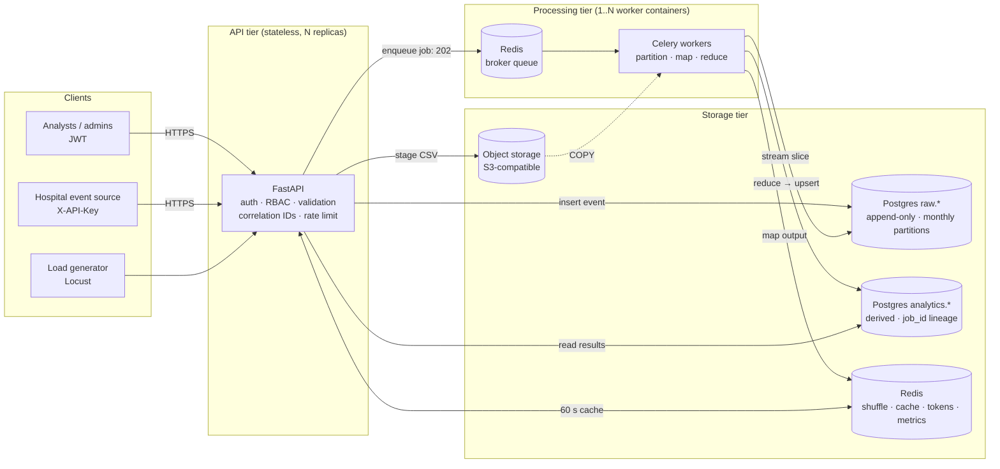
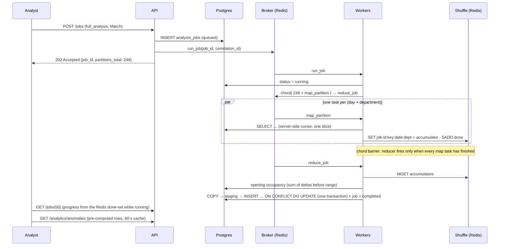

# Architecture

## System diagram

**The defining property is a negative one: there is no path from the API tier to a worker.** All work crosses the
broker. That is what allows the request path and the processing path to scale, and to fail, independently. Everything
above the broker scales on request volume; everything below it scales on data volume.

## One job, end to end

## Components

| Component | Responsibility | Why it is separate |
|---|---|---|
| FastAPI service | validate, authenticate, persist raw events, enqueue jobs, serve results | stateless: replicas are interchangeable |
| Redis broker | job queue with late acknowledgement | decouples request from work |
| Celery worker pool | partition, map, reduce | the scaling unit; replica count is the throughput dial |
| Postgres `raw.*` | immutable append-only event log | source of truth; every result is regenerable from it |
| Postgres `analytics.*` | derived metrics and the job ledger | small, read-hot, rewritable: opposite of raw |
| Redis (shuffle) | map output grouped by reducer key; job progress | ephemeral, read-once; wrong for Postgres |
| Redis (cache) | 60 s TTL on analytics responses, bumped on job completion | keeps repeated reads off the database |
| Object storage | bulk CSV uploads | large blobs do not belong in rows or in the API |

Four logical Redis databases are used: `0` broker, `1` cache + metrics + rate limits + refresh tokens, `2` Celery
results (chord bookkeeping), `3` shuffle + job progress.

## Why these technology choices

* **PostgreSQL, not MongoDB or Cassandra.** This is an aggregation project: the dominant operation is grouping millions
  of rows by time and category. Postgres has window functions, native monthly partitioning with pruning, `COPY`, full
  ACID (a reducer writes all rows or none), and a fixed schema that catches generator bugs early. Redis (key-value) is
  used for the two things it is strictly better at: ephemeral shuffle data and result caching. The accurate framing is
  *relational for durable aggregated state, key-value for ephemeral hot state*.
* **Celery chord, not Spark/Hadoop.** At 1M rows (~60 MB) Spark's distribution overhead exceeds the work. A chord gives
  the identical logical structure (partition → map → shuffle → reduce) with real process-level parallelism across
  containers. The scheduler and storage layer differ from Hadoop; the computational model does not.
* **Containers, not serverless.** A Celery worker is a long-running process polling a broker. The failure and scaling
  demonstrations both need containers that can be counted and killed.

### The MapReduce mapping

| MapReduce concept | Implementation |
|---|---|
| Input split | (day × department) partition |
| Mapper | Celery task, pure function over one partition |
| Combiner | pre-aggregation inside the map task before it emits |
| Partitioner / shuffle | Redis keys namespaced by reducer key |
| Barrier | Celery chord header completion (plus a done-set check in the reducer) |
| Reducer | chord callback folding accumulators per key |
| Output | `analytics.*` tables |
| Speculative re-execution | redelivery of unacknowledged tasks (`acks_late`) |

Because the map output key is `(date, department)` and the partition is exactly one `(day, department)`, the shuffle
is one-to-one here; the reduce stage does the real cross-key work (running occupancy sums, rolling baselines).

## Data-model decisions

* **Partitioned by month** on `event_time`: a March query scans one partition, not 36.
* **Composite primary keys on result tables** make writes idempotent, which is what makes the failure experiment safe.
* **`job_id` on every derived row**: any number in any response traces to the run, parameters and timing that produced it.
* **No patient table.** Patients are opaque pseudonymous references: a deliberate privacy-preserving choice.
* **Hourly grain for occupancy**: a ward can run at 100% all morning and 40% all night; a daily average hides it.
* **Append-only trigger** on the raw table: corrections are new events, never edits.

## Reliability design

| Mechanism | Where | Effect |
|---|---|---|
| `acks_late` + `task_reject_on_worker_lost` | `celery_app.py` | an unfinished task is redelivered, not lost |
| `worker_prefetch_multiplier=1` | `celery_app.py` | a crash strands at most one task per process |
| 45 s visibility timeout | `celery_app.py` | a dead worker's tasks come back in seconds, not an hour |
| Pure map tasks | `map_tasks.py` | re-execution gives identical output |
| Idempotent upserts | `reduce.py` | a duplicated or re-run reduce overwrites |
| Reducer re-verifies the barrier | `reduce.py` | an early-fired chord waits instead of reducing partial data |
| Final-status guard | `reduce.py` | a redelivered reducer after completion is a no-op |
| Retry with backoff, then fail cleanly | `tasks.py` | transient vs permanent failures are distinguished |
| Fail-open Redis for non-critical use | `core/redis.py` | cache, metrics, rate limits never take ingestion down |
| `503` for broker/DB unavailable | `services/jobs.py`, `core/errors.py` | honest degradation, not a hang |

## Extending it (live-modification guide)

* **Add a fourth aggregate** (e.g. surgeries per day): three places. (1) `map_tasks.py`: `fold_row` already counts
  `surg`; emit what you need into the accumulator. (2) `reduce.py`: `compute_results`, add it to the row dict.
  (3) the response schema (`schemas/analytics.py`) and, if persisted, a migration column + `_ADMISSION_COLS`.
* **New filter on an endpoint**: add a `Query` parameter and a `WHERE` clause in `api/v1/analytics.py`; include it in
  the cache-key dict next to it.
* **New RBAC role**: add it to `Role` in `core/security.py` with a rank; extend the `CHECK` constraint in a migration.

## Known limits and how they would be addressed

* **Single region, single Postgres.** Read replicas for the query tier; managed HA Postgres.
* **No dead-letter queue** for permanently failing partitions: they are recorded on the job (`partial` +
  `error_detail`) and can be re-run, but are not parked automatically.
* **The shuffle is memory-bound in Redis** (a few thousand small keys per 1M events; fine here, finite at 100M).
* **The reduce stage is serial** (Amdahl): that is why 4× the workers gives less than 4× the speed. At 100M events:
  partition by week, move shuffle to object storage, shard the reduce by department, and switch to Spark.
* **Anomaly detection is univariate** per department and metric, with a deliberately simple statistical model; its
  precision on high/critical windows is reported honestly in the benchmark output.
